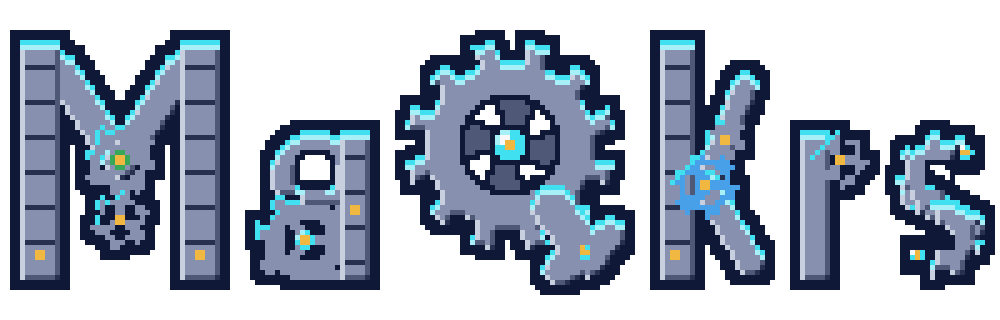

<p align="center">
  
  <br>
  
</p>

# MaQkrs

This repository is an earlier public snapshot of a macOS study app. It is for a student who wants to keep course files on their own Mac and ask questions through a local model. The current product is [MaQkrs AI Tutor (pre-release beta): cited answers, on your device.](https://www.nonartificialsi.com/maqkrstutor)

**Status:** Earlier public snapshot. The app in this tree sends chat and embeddings to a local Ollama process. It is not the current MaQkrs AI Tutor build.

Not deployed · Part of [Andrew Strachan's portfolio](https://www.nonartificialsi.com)

## What it does today

- Opens course workspaces, study sessions, and a document list in a SwiftUI sidebar.
- Accepts PDF, text, Markdown, and source files as study material. Images can be attached to a prompt. Audio and video uploads are rejected.
- Resolves each turn before generation: a document named in the prompt, one newly added document, the focused document, or the previous reply when the prompt is a bare translate.
- Stops and asks for one document when several new files are staged and the prompt says "this" document. Summarize, translate, and practice also stop when no document is selected. Tutor and explain can continue without one.
- Sends the focused document's extracted text with the prompt. PDF text comes from PDFKit, and a page with no text layer is read with Vision.
- Can store embeddings in a local sqlite-vec database and attach retrieved chunks to a reply. The chat screen's file importer uses direct text and does not turn indexing on.
- Streams a reply from Ollama on this Mac, and keeps a separate reasoning buffer when the model returns one.
- Lists chat models installed in local Ollama. The source includes a curated order for the tags in `ModelCatalog`.
- Speaks a model reply on the Mac with AVSpeechSynthesizer. The language menu is English, Turkish, Hindi, Swahili, Mandarin, and Bengali.
- Saves a summary, translation, or practice set as a local SwiftData record, and exports a session to Markdown.

## Planned

- Chat through MLX. The Xcode project links mlx-swift, and the Swift sources do not call it. [planned]
- Tree-sitter and semantic chunking through PythonKit. The scripts are stubs, and the app splits text with a sliding window. [planned]
- Transcripts for audio and video. [planned]
- Quiz-card decks. The model types exist, and no screen builds a deck. [planned]

## How it's built

- SwiftUI interface and SwiftData store. The shared Xcode project sets the macOS deployment target to 26.3.
- Chat and embedding requests go to Ollama at `http://localhost:11434`. This snapshot does not call a cloud model API.
- SQLiteVec holds vectors. MarkdownUI renders Markdown replies.
- Sidebar colors use the MaQkrs palette in `MaqkrsTutor/UI/MaQkrsPalette.swift`: navy `#182048`, sky blue `#2F64C8` and `#4888E8`, leaf green `#3F9E40`, white `#FFFFFF`, and steel gray `#7880A0`. Cyan `#30D8F8` and gold `#F8D030` are limited to the selection bar and status dot. The accent color is `#2F64C8` in light appearance and `#88B0F8` in dark appearance (`#88B0F8` is 6.38:1 on `#2c2c2e`). The model-name labels use A1 accent text `#2458B8` on `#E8F1FD` in light (5.83:1) and `#9CC0FA` on `#182457` in dark (7.93:1).

## Run it locally

On a Mac, from the project root:

```sh
open MaqkrsTutor.xcodeproj
```

In Xcode, select the MaqkrsTutor scheme and run it. The placeholder bundle identifier is `com.example.MaqkrsTutor`. Set your own team if the run requires a signature.

Install Ollama and start it on the same Mac. Pull a chat model and the embedding model named by `ModelManagerConfig.embeddingModel` (`nomic-embed-text:v1.5`) before you expect retrieval. This snapshot does not read an env file. `.env.example` is blank on purpose.

## Tests and checks

From the project root:

```sh
node scripts/check-claims.mjs
node scripts/check-emoji.mjs
gitleaks dir . --redact
```

Unit tests are the Swift Testing suite in `MaqkrsTutorTests` (17 tests). UI tests are in `MaqkrsTutorUITests`. Run both from Xcode on a Mac with the MaqkrsTutor scheme.

## Security

No secrets are committed. This snapshot has no API keys. Chat and embeddings stay on the machine and talk only to local Ollama. Report a security issue only through the [private vulnerability advisory](https://github.com/astrachan163/MaqkrsTutor-public/security/advisories/new) on this repository. For questions that are not security reports, write to strachan@uab.edu.

## Credits

Author: Andrew Strachan.

## License

MIT. See [LICENSE](LICENSE).
